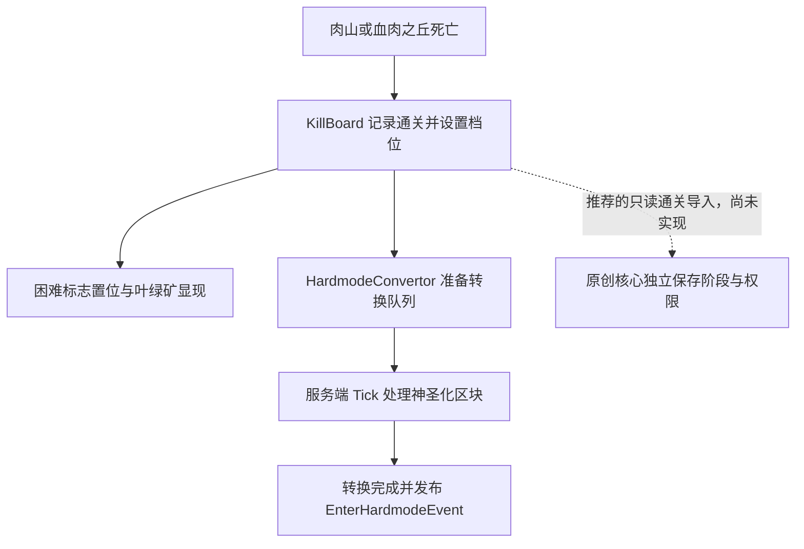

# 汇流来世进度兼容调查

调查日期：2026-10-10（Asia/Shanghai）。基线提交：`4d827d3`。用户批准的是只读调查、方案与记录，不包含实现、安装、配方调整、游戏启动或存档操作。

**结论：当前版本有可读取的通关与阶段接口，可以与独立世界进度核心联动；不能仅凭几个配置开关就安全接管全部原生进度。建议第一版保留原生机制，让原创核心单向读取通关事实，并维护自己的阶段和资源权限。** 这是调查后的建议，尚未作为最终设计批准，也没有实现。

如果要求“原创主线未到指定阶段，玩家绝对不能触发原生困难模式”，上述单向读取不足以满足要求：原生肉山/血肉之丘死亡会直接改状态并启动世界转换。必须另行批准并验证召唤与触发入口的门槛，或采用更深入的适配，不能用转换后的通知事件冒充前置拦截。

## 1. 核查对象与证据口径

| 项目 | 核实结果 |
|---|---|
| 当前开发实例 JAR | `[汇流来世] ConfluenceOtherworld-1.2.4-260226.jar` |
| 模组 ID / 元数据版本 | `confluence` / `1.2.4` |
| JAR 大小 / SHA-256 | 35,564,736 字节；`B86BF2EF565760127D7C1E0E8E7FCE0B71E3F7C08056066C2DD6AD56F1E4D0B6` |
| 内嵌实体模组 | TerraEntity `1.2.1`，ID `terra_entity`；不能只检查顶层模组文件名 |
| 内嵌共享数据库 | Confluence Magic Lib `0.0.8` |
| 当前项目平台 | Minecraft 1.21.1 / NeoForge 21.1.248 / Java 21 |
| 核查方法 | 本机 JAR 资源与配置、43 个类的 `javap` 静态反汇编、发布时附近的公开源码交叉核对 |

证据首先以当前 JAR 为准，不把上游最新分支或更高版本的功能当成本机功能。[作者发布页](https://modrinth.com/mod/confluence/version/SvvNcTJh)对应 1.2.4-260226；从上游 GitHub API 定位到发布前提交 `08d2e722e136bc96c4a85f8ba95daf5185cf7bc2`，提交说明为 `1.2.4`，时间为 2026-02-25 17:01:01 UTC。已取得 9 个相关源码文件，关键路径与本机反汇编相互印证，但没有重新构建上游工程以证明整个 JAR 与该提交二进制等价。

源码定位见[该提交的 KillBoard](https://github.com/Magic-team-jvav/confluence/blob/08d2e722e136bc96c4a85f8ba95daf5185cf7bc2/ConfluenceOtherworld/src/main/java/org/confluence/mod/common/data/saved/KillBoard.java)，下载 URL 与文件哈希见 `evidence/confluence-audit/upstream-sources.json`。公开源码只留在忽略的任务工作目录，仓库保存调查资料与关键反汇编证据，不保存第三方模组 JAR。

本轮没有读取存档 `level.dat` 或区块文件。以下描述的是代码行为和配置快照，不是某个现有世界的实际阶段，也不是游戏内兼容性已经通过。

## 2. 原生进度包含多份相关状态

| 状态 | 当前实现 | 对原创核心的含义 |
|---|---|---|
| Boss / 入侵通关事实 | `KillBoard.INSTANCE` 的 `defeatedBosses`、`defeatedEvents` | 可按实体类型/事件键查询；世界共享，不是每个玩家的等级 |
| 阶段档位 | `KillBoard.getGamePhase()` | 是原生档位，不应与原创阶段编号直接等同 |
| 困难模式标志 | `IMinecraftServer.isHardmode(server)`，检查 world options 的位 `4` | 与阶段档位分开存储；不能仅凭档位名称代替这个状态 |
| 地形转换状态 | `HardmodeConvertor.isStarted()` / `isCompleted()`，待处理队列 | “Boss 已死”“困难标志已置位”“转换已完成”不是同一时刻 |
| 矿物显现状态 | `ConfluenceData.revealStep` + `GlobalCloakData` | 另有祭坛路径，不能只管理 Boss 标记就认为控制了全部矿物 |

`KillBoard` 实现内嵌库的 `IGlobalData`，通过 PrimaryLevelData 的序列化注入写入世界主数据，键为 `confluence:kill_board`，字段为 `defeated_bosses`、`defeated_events`、`game_phase`。`GlobalCloakData` 也采用共享数据机制，键为 `confluence:global_cloak_data`。

`ConfluenceData.get(ServerLevel)` 则使用该维度的 `DimensionDataStorage`，保存名为 `confluence`，记录显现步数等信息。世界共享通关事实、维度 SavedData 与 world options 标志混合存在；适配不能把它们都当成同一个普通 SavedData 文件。

原创核心应使用自己的保存键与数据版本，不写入这些原生键、不修改 `IGlobalData.DAT`，也不通过直接改 NBT 假造原生通关。

## 3. 七个基础阶段不等于完整自动 Boss 链

| 原生名称 | `order` | 当前静态核查 |
|---|---:|---|
| `BEFORE_SKELETRON` | 0 | 默认骷髅王前 |
| `AFTER_SKELETRON` | 100 | `KillBoard.defeat` 对骷髅王直接设置 |
| `WALL_OF_FLESH` | 200 | 对肉山或血肉之丘直接设置，随后触发困难模式相关副作用 |
| `MECHANICAL_BOSSES` | 300 | 枚举存在；该常规通关路径没有自动推进到它 |
| `PLANTERA` | 400 | 枚举存在，世纪之花实体也存在；不能据此认定档位自动推进已实现 |
| `GOLEM` | 500 | 枚举存在；本版内嵌 `TEBossEntities` 未见对应原生 Boss 注册项 |
| `MOON_LORD` | 600 | 枚举存在；本版内嵌 `TEBossEntities` 未见对应原生 Boss 注册项 |

当前主 JAR 中直接引用 `setGamePhase` 的类只有 `KillBoard` 与 `ModCommands`，内嵌 TerraEntity 没有直接引用。这个结果限定于当前版本的静态路径，不用于否定其他模组或未来版本的扩展。

机械三王的通关事实可以分别读取。`isAnyMechBossDefeated()` 的意思是**任意一只**机械 Boss 已通关，不能把它当成“三只全部完成”。若原创章节要求三王全部完成，应分别检查以下实际实体类型：

| 内容 | 根实体 ID |
|---|---|
| 骷髅王 | `terra_entity:skeletron` |
| 肉山 / 血肉之丘 | `terra_entity:wall_of_flesh` / `terra_entity:hill_of_flesh` |
| 机械毁灭者 | `terra_entity:the_destroyer` |
| 双子魔眼 | `terra_entity:the_twins` |
| 机械骷髅王 | `terra_entity:skeletron_prime` |
| 世纪之花 | `terra_entity:plantera` |

肉山眼/嘴、毁灭者节段、双子的单体、机械手臂和世花触须等不能一律当作独立主线 Boss。第一版应按明确的根实体白名单判定，后续对双子和多部件死亡语义实测。

### 一个需要保留的回归测试

`KillBoard.defeat` 无论是否重复击杀，都会对骷髅王设置 `AFTER_SKELETRON`；`setGamePhase` 本身直接赋值，没有“只升不降”检查。常规死亡链 `LivingEntityEvents → ModUtils.bossDeath → KillBoard.defeat` 也没有在调用前检查是否已通关。

因此，**困难模式后重复击杀骷髅王，可能使档位回到 100，而困难标志和已显现矿物仍保留**。world options 的标志更新使用按位 OR，不会因为降档就自动撤销困难模式。这是当前代码路径支持的静态风险，尚未在游戏中复现；需要加入后续回归测试。

原创核心的完成记录与阶段推进必须自行保证幂等、只升不降。导入通关时检查 `isDefeated` 的实际布尔值；不要只读取集合数量或把原生当前档位当成唯一历史事实。

## 4. 困难模式转换与事件时机

在本版中，肉山或血肉之丘死亡先写通关事实和档位；设置到困难档位会置困难标志、显现叶绿矿，并启动 `HardmodeConvertor`。它根据出生点和世界高度生成神圣化区域队列，在对应世界的 `LevelTickEvent.Post` 继续处理。

`instantlyHardmodeConversion=false` 时走分批分支，通常每 5 个游戏刻尝试一个队列区块，涉及临时强制加载；不是用户计划中按每刻方块预算执行的通用补矿系统。转换会将可替换方块神圣化，不能据此保证玩家放置的普通石头等材料受到保护。

**`EnterHardmodeEvent` 在转换队列处理完成后发布**。它继承 `Event`，没有实现 `ICancellableEvent`，只有服务器访问器。不能用它取消初次转换，也不能用它精确代表 Boss 刚刚死亡。入口、原生困难标志和转换完成时刻应分别记录。

TerraEntity 的 `TEBossEvent.Summon` 确实可取消，提供实体类型与玩家信息，可作为未来提前召唤限制的候选入口；它不能被假定覆盖所有直接生成、结构、存档加载和其他模组的召唤路径。本轮没有验证这些路径，未实现拦截，也不提出仅凭此事件就保证完全接管。

## 5. 矿物显现与通用 Retrogen 要分开

困难模式下玩家破坏祭坛时，`AltarBlock.playerDestroy` 调用所在维度 `ConfluenceData.increaseRevealStep()`，随后经 `GlobalCloakData.reveal` 修改隐藏状态并同步客户端。`StepRevealingBlock.PAIRS` 涉及：

- 钴 / 钯。
- 秘银 / 山铜。
- 精金 / 钛。

步数开始为 `-1`；本版数组有 9 个显现批次，按三种矿物组与 `reveal_step` 状态分批开放。它主要显现原生世界生成中已经存在的隐藏矿物，**不会替没有这些矿物的任意旧区块凭空补出矿石**。

因此，原创核心的 Retrogen 第一版宜使用独立测试矿物和自己的每区块处理标记，避免同时对这些原生矿物做第二轮生成。确定正式矿物清单后，再决定谁负责显现、谁负责物理生成。不能把“模板禁止生成矿物”“矿石被隐藏”“旧区块已经补矿”当成同一项验收。

本版还有 `confluenceSpreadableChance` 游戏规则，注册默认值为 10，范围 0–100；本轮未读实际存档的规则值。它与初次神圣化队列不是同一个控制入口，转换主路径没有读取该规则，不能把调整传播机会等同于关闭初次世界转换。

## 6. 配置与其他门槛

以下是 `config/confluence-common.toml` 的当前文件快照，不代表所有存档中正在运行的状态：

| 配置 | 当前值 | 解释 |
|---|---|---|
| `WorldGeneration.instantlyHardmodeConversion` | `false` | 改变转换调度方式，不是关闭困难模式或转换 |
| `Gameplay.allowsVanillaEntitiesToPerformStageAttributes` | `false` | 阶段属性修饰过滤 `minecraft` 命名空间；不代表全部模组生物都没有阶段修饰 |
| `Spawning.Boss.eyeOfCthulhuNatureSpawning` | `true` | 自然 Boss 生成目前允许，需结合家园安定目标评估 |
| `Spawning.Boss.deerclopsNatureSpawning` | `true` | 同上，不应只控制合成召唤物就认定没有其他入口 |
| `Spawning.doMeteoriteSpawning` | `true` | 世界变化的另一条路径，不属于单纯的阶段通知 |

未在检查的 common/startup 配置中发现能统一禁用通关阶段写入、初次神圣化与原生矿物显现的总开关。

原生阶段还参与实体数据映射 `GamePhase2AttributeModifiers`、战利品区间条件 `GamePhaseLootItemCondition`、NPC/交易与微光转化等路径。属性应用代码跳过玩家及和平/简单难度，并依据当前档位选择数据映射。设置一个档位可能影响多个系统，不是只解锁矿物。

已有管理员命令 `/confluence gamePhase get` 和 `/confluence gamePhase set <value>`，根命令要求权限等级 2。`set` 会经过带副作用的 setter，不是无害查询；本次没有执行任何游戏命令。尤其直接设置毕业档位与经过正常困难转换的路径不同，不能将管理员跳阶段的结果当作正常流程验收。

## 7. 三种衔接方案

| 方案 | 适合目标 | 代价与限制 | 建议 |
|---|---|---|---|
| 保留原生进度，原创核心只读导入 | 半开放探索；原生 Boss 与自己的科技/资源阶段并存 | 不能阻止肉山提前改变原生世界；正式剧情须协调这一分界点 | **首选 MVP 技术路线** |
| 控制召唤入口并协调共享分界点 | 要求原创主线控制困难模式时间 | 要检查召唤物、自然生成、NPC 献祭、直接实体生成等路径；不能依赖转换后事件 | 后续单独设计与实测 |
| 全面接管或替换原生写入 | 原生阶段完全服从原创阶段 | 需针对本版拦截实际调用，处理保存、同步、矿物、NPC 和转换副作用；升级成本高 | 不作为当前第一步 |

主项目 README 还列有[Confluence Dimension Patch](https://github.com/Magic-team-jvav/Confluence-Dimension-Patch)，用于将汇流对主世界的修改转移到新维度，可作为保护固定家园的候选。**本轮未安装、未核实具体发行文件与 1.2.4 的匹配，也未证明世界共享阶段会因此隔离**；不能当成现成兼容保证。

### 推荐 MVP 边界

1. 在自己的 world SavedData 中保存 `schemaVersion`、阶段 ID 和已完成里程碑，使用独立命名空间，保证同一通关不重复晋级或发奖。
2. 主线阶段数、正式 Boss 顺序及奖励仍待用户设计；先用明确标注为测试用途的可配置映射验证机制，不自动选定正式肉山章号。
3. 可选 Confluence 适配层读取 `KillBoard.isDefeated` 等事实；客户端收到的是服务端快照，离线玩家进入世界后也能看到共享阶段。
4. 服务器启动后与死亡处理结束的安全时机对账，支持旧世界已完成里程碑的导入。不要每刻重写 `setGamePhase`，不直接调用 `defeat` 假造 Boss 通关，也不修改返回的原生集合。
5. 原生档位、困难标志和转换完成分别作为观察信息；原生档位回退不会撤销原创核心已经确认的完成记录。
6. 原创核心的调试重置只重置自己的数据，不声称回滚原生困难模式、矿物、地形或玩家奖励。
7. 资源模板制作与生成器实际产出都要经过阶段检查，Boss 独有掉落等另设不可复制策略；这些联动需要新的实现任务，本轮不修改无限之核。
8. 单人与多人优先采用世界共享通关。最后一击、女仆/召唤物参与和个人奖励另行定义，不为了归属处理漏掉真实 Boss 死亡。

首版适配应绑定已核查版本；`KillBoard` 等公共方法是可用的内部接口，不是作者承诺永远稳定的 API。Confluence 未加载时，核心自己的保存、命令与普通 Boss 配置仍应可用，避免可选依赖类在启动时提前解析。

## 8. 实现后需要验证的用例

| 用例 | 预期检查 |
|---|---|
| 未安装 Confluence | 核心能独立启动，普通测试映射不失效 |
| 正式根实体死亡 / 子部件死亡 | 前者按配置推进一次；后者不冒充完整 Boss 通关 |
| 取消死亡、非死亡移除、重复击杀 | 不提前或重复推进，不因卸载实体发奖 |
| 肉山和血肉之丘两条入口 | 原生分界点与原创里程碑的映射按设计一致 |
| 困难模式后重打骷髅王 | 核对原生档位、困难标志与原创阶段，确认静态回退风险的实际表现 |
| 机械三王只杀一只 / 三只完成 | 精确区分 any 与 all，完成计数不包含部件 |
| 转换开始、进行中保存、重启及结束 | 里程碑、标志、转换状态分别正确，不把通知遗漏当成通关丢失 |
| 多人、离线加入、跨维度、重载 | 世界共享数据与客户端同步一致，没有同一单人进程切换世界时的残留 |
| 带阶段资源的模板和自动输出 | 制作与实际产出均受规则约束，不能用旧模板绕过 |
| 补矿与原生隐藏矿并存 | 两套标记/生成职责明确，不重复加矿或覆盖建筑 |

本轮没有执行这些用例。静态字节码核查确认接口、存储键和调用链，不能替代游戏内事件顺序、存档恢复与生态平衡验收。

## 9. 本轮交付与接续

报告和 `evidence/confluence-audit` 保存了对象哈希、配置快照、公开源码定位、调用引用及 19 组关键反汇编证据。原 JAR 与 3 个已读取配置文件在结束时再次核对 SHA-256 一致。本轮没有读取或改写世界数据，没有启动游戏，没有安装分析工具或模组，也没有推送 GitHub。

下一项候选任务是 **世界进度核心 MVP 骨架**：独立保存、数据驱动 Boss/阶段映射、查询/管理员调试命令、一次性通知与简单阶段查询接口；先按测试配置验证，不绑定正式剧情、不强制写原生阶段、不做 Retrogen、不部署实例。开始前应再次告知具体改动范围、编译/测试步骤并询问用户。
